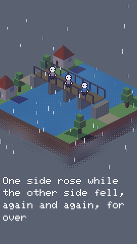
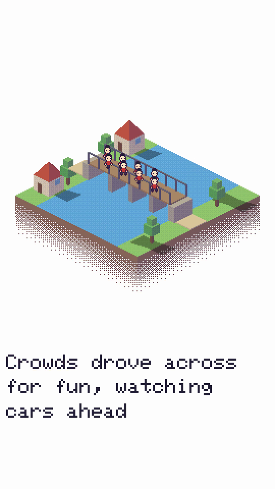
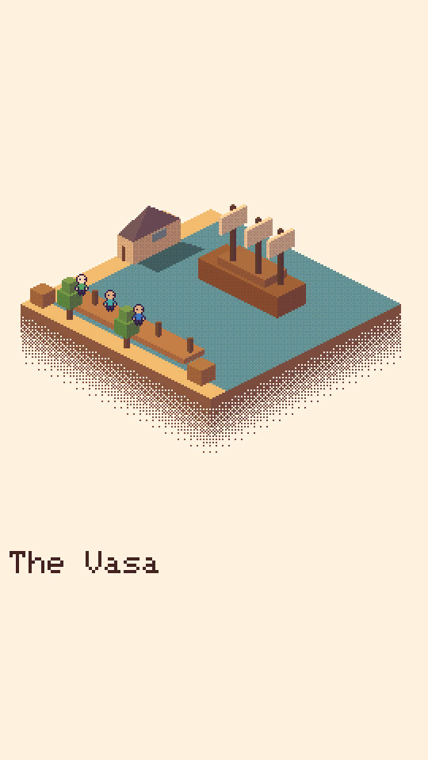
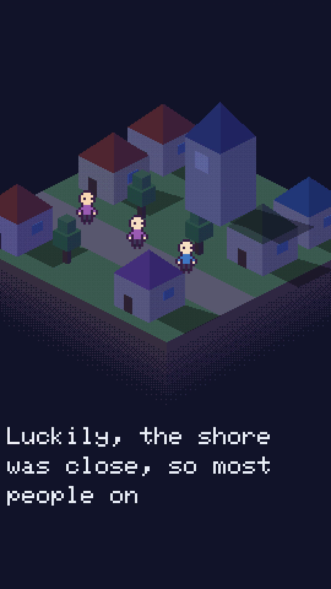
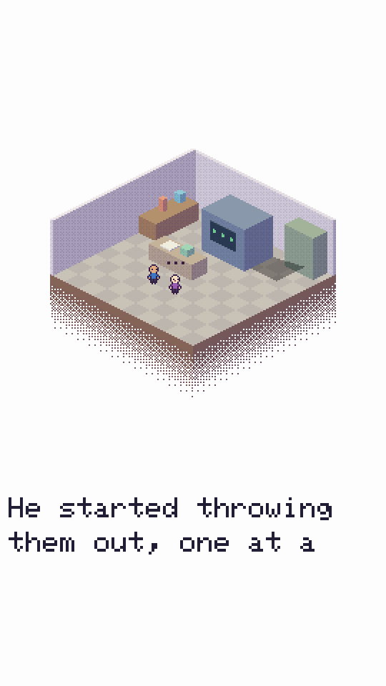
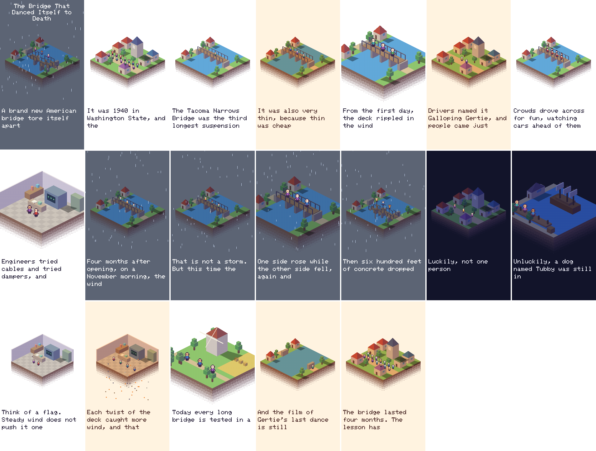

<div align="center">

# pixelshorts

**Turn a one-page story into a 60-second animated short, with no API key, GPU or Remotion.**

Animated story shorts are all over YouTube and TikTok, and [claude-animated-shorts](https://github.com/mromidev/claude-animated-shorts) showed they can be made without an AI video generator. This takes the same script formula and renders it in plain Python, in the style of [Pixel Plays](https://github.com/amirmushichge/pixel-plays).

Works with **Claude Code** and **Codex**.

  



<sub>Real output, from <a href="examples/bridge.txt">examples/bridge.txt</a>. The full video is 64 seconds with score and sound effects.</sub>

</div>

## Quick start

```bash
git clone https://github.com/Dodai0419/pixelshorts && cd pixelshorts
python pixelshorts.py render examples/bridge.txt -o short.mp4
```

```text
wrote short.mp4: 64.0 s, 19 beats, 1080x1920
```

You need Python 3.9 or newer and ffmpeg. There is nothing to install, and nothing goes over the network.

### Install in Claude Code

```bash
/plugin marketplace add Dodai0419/pixelshorts
/plugin install pixelshorts@pixelshorts
```

Then say: *"Make a short about the Great Fire of London."*

### Install in Codex

```bash
git clone https://github.com/Dodai0419/pixelshorts && cp -r pixelshorts/skills/* ~/.codex/skills/
```

Or copy `AGENTS.md` to your project root.

## The problem

- A story short made with an AI video generator costs money per clip, and the characters change from shot to shot.
- The free route through Remotion and three.js works, but it needs Node, a 3D project, and a `public/` folder that upstream's README puts at about 1.3 GB.
- Your agent can write a great script, then has no way to turn it into a video by itself.

## The solution

| Idea | Fixes |
|------|-------|
| **A story is a text file** | Your agent writes one line per beat: place, light, action, narration. There is no timeline to edit |
| **Pixel art is cheap to draw** | Frames are 270x480 and scale up by exactly 4. A pure Python renderer can draw a whole short in seconds |
| **Everything is synthesized** | Picture, march score and sound effects come from code, so there is no asset to license and no key to buy |
| **Same seed, same film** | A rerun gives identical frames, so a change to one line is the only change you see |
| **`qa` watches the result** | It finds black, frozen, pop and silent problems before you post |

## Gallery

All of these are real frames from the stories in [`examples/`](examples/), with no retouching.

| The bridge marches | The Vasa in harbor | The Vasa sinks | A messy lab |
|---|---|---|---|
|  |  |  |  |

Every beat of `examples/bridge.txt`, from one `stills` command:



## Write a story

A story is a text file. Each line is `place light action: narration`.

```text
# Tacoma Narrows, 1940. Keep your facts and sources in comments like this one.
title: The Bridge That Danced Itself to Death
bridge storm collapse: A brand new American bridge tore itself apart in a breeze.
town day crowd: It was 1940 in Washington State, and the town was proud.
bridge day walk: The Tacoma Narrows Bridge was the third longest suspension bridge in the world.
bridge day shake: From the first day, the deck rippled in the wind like a slow wave.
```

| Word | Choices |
|---|---|
| place | `bridge`, `town`, `harbor`, `lab`, `field` |
| light | `day`, `golden`, `night`, `storm` |
| action | `stand`, `walk`, `march`, `crowd`, `talk`, `shake`, `collapse`, `flash`, `rain`, `boom` |

A beat lasts as long as its words take at 3.7 words per second, the pace upstream measured. Words appear in the caption at that pace.

What each action does:

| Action | On screen | In the sound |
|---|---|---|
| `stand` | Three people, idle | Score only |
| `walk` | One person crosses | Footsteps |
| `march` | A column of soldiers in step | Boots on the beat |
| `crowd` | A waving crowd | Score only |
| `talk` | Two people, with speech dots | Small blips |
| `shake` | The main structure shakes harder and harder | A rising rumble |
| `collapse` | It breaks into columns that fall at different speeds, with debris | A crash, and a splash over water |
| `flash` | A white flash | A thump |
| `rain` | Falling rain. `storm` light has it too | Rain noise |
| `boom` | A burst of sparks and a shake | A low boom |

After a `collapse`, the structure stays gone for the rest of the film. In the very first beat it does not, so you can open on the disaster and then go back in time.

## The script formula

This is what makes a short hold attention. It comes from upstream's measured style notes, and the skill tells your agent to follow it.

1. **Hook:** the absurd fact in one line.
2. **Setting:** year, place, pride.
3. **Action:** three or four beats, each a little bigger.
4. **Snap:** the moment it breaks.
5. **Deadpan pair:** "Luckily ..." then "Unluckily ...".
6. **Explanation:** one idea through an everyday comparison.
7. **Consequence:** the rule it created.
8. **Callback:** an ending that returns to the hook.

`check` tells you when a story is outside the 55 to 70 second range, when the hook runs long, and when nothing breaks.

```bash
python pixelshorts.py check examples/bridge.txt
```

```text
19 beats, 64.0 s at 3.7 words/s
 1.  3.0 s  bridge storm collapse
 2.  3.0 s  town day crowd
 3.  3.5 s  bridge day walk
...
```

## Commands

| Command | What it does |
|---|---|
| `render story.txt -o short.mp4` | Makes the video |
| `check story.txt` | Prints the plan and any notes. Draws nothing |
| `stills story.txt -o stills` | Writes one PNG per beat, to judge the look quickly |
| `qa short.mp4` | Checks a finished video, from any source |
| `--demo` | Renders the bridge short to your temp folder and checks it |

Options for `render`:

| Option | What it does |
|---|---|
| `--voice voice.wav` | Stretches the picture to fit your narration. The score ducks under it |
| `--no-captions` | Leaves the lower third empty. Needed for languages other than English |
| `--seed N` | Another cast and camera drift. The same seed gives the same frames |
| `--2k` | 1440x2560 instead of 1080x1920 |

Exit codes: `0` success, `1` `qa` found a problem, `2` refused or bad input. A failed render leaves no partial file behind.

## Check a video

```bash
python pixelshorts.py qa short.mp4
```

```text
64.0 s, 768 frames checked, loudness -16.6 LUFS
qa: clean
```

It reports black frames, blank white frames, stretches frozen for over 2.5 seconds, single-frame pops, and a missing or silent sound track. It works on any video, so use it on footage from other tools as well. It exits with `1` when it finds a problem, so an agent can loop until it is clean.

## Add your own voice

pixelshorts makes no speech. Record a voice, or use any text-to-speech tool you like, then:

```bash
python pixelshorts.py render story.txt -o short.mp4 --voice voice.wav
```

The film takes the length of the voice file, every beat stretches by the same amount, and the score and effects duck under the voice. Your agent can drop the captions with `--no-captions`, which is also the way to narrate in a language the pixel font cannot draw.

## Why this instead of claude-animated-shorts

| | claude-animated-shorts | pixelshorts |
|---|---|---|
| Look | Flat characters in a painted 3D town, with lens blur and bloom | Isometric pixel dioramas |
| What you write | A shot plan in TypeScript, with per-shot cameras | One text line per beat |
| What you need | Remotion, `@remotion/three`, Node, Python, ffmpeg | Python, ffmpeg |
| Reference and asset folders | About 1.3 GB copied per bundle, by its README | None |
| Voice | You supply it, with hand-fixed word timings | You supply it, optional. Beats stretch evenly |
| Sync to words | Every reaction lands on its word | Per beat only |
| Score and SFX | Synthesized, with stems | Synthesized, one mix |
| Frame check | `short_qa.py`, plus agents comparing to reference frames | `qa` and `stills` |
| Sound effects tied to picture | Yes | Yes, from one beat table |

**Use upstream** if you want the richer 3D look and can spend the time on a Remotion project. It looks better than this. **Use this** when you want a finished short from your agent in about a minute, on a laptop, with no project to set up.

## Benchmarks

Windows 11, Python 3.11, laptop, best of 3; the low end is a quiet machine, the high end a busy one. Run it yourself with `python bench/bench.py`. Encoding is the slow part and depends on your CPU.

| | claude-animated-shorts | pixelshorts |
|---|---|---|
| Draw all frames of a 64 s short | not measured | 2 to 3 s |
| Score and SFX | not measured | 2 to 3 s |
| Full render to mp4, 1080x1920 | not measured | 22 to 35 s |
| Output size | not measured | 4.2 MB |
| Dependencies | Remotion, three.js, Node, Python, ffmpeg | Python standard library, ffmpeg |
| Code | 7,441 lines of templates and scripts | 889 lines, one file |

Upstream was read, not run. It needs a Remotion project with its assets in place, so its column stays "not measured" rather than a guess.

## Known limits

- The pixel font draws English text only (ASCII, with curly quotes and dashes converted). Anything else is refused with a clear message. Use `--no-captions` with `--voice` for other languages.
- There are five places. A story set in a castle has to borrow `town`.
- Output frames are 270x480 scaled up. The chunky look is the style, and it will not pass for 3D.
- Beats stretch evenly to a voice file. Lip-sync and word-level reactions are not supported.
- Characters do not cast shadows of their own, and a crowd can overlap buildings near the road.

Tested on Windows 11 with ffmpeg 9. It has not been run on macOS or Linux.

## Run the tests

```bash
python -m unittest -q
```

## Inspired by

- [mromidev/claude-animated-shorts](https://github.com/mromidev/claude-animated-shorts): the script formula, the pace, the idea of synthesized sound on one beat table, and a frame-by-frame check.
- [amirmushichge/pixel-plays](https://github.com/amirmushichge/pixel-plays): the look, meaning the small frame, isometric camera, dither, colour ramps and long shadows. No code or music was copied.

## Roadmap

- [ ] More places: a castle, a ship deck and a mountain.
- [ ] Word-level timing from a `words.json` file.
- [ ] Characters that can hold a prop.

## License

MIT. See [NOTICE](NOTICE) for the projects this builds on.
